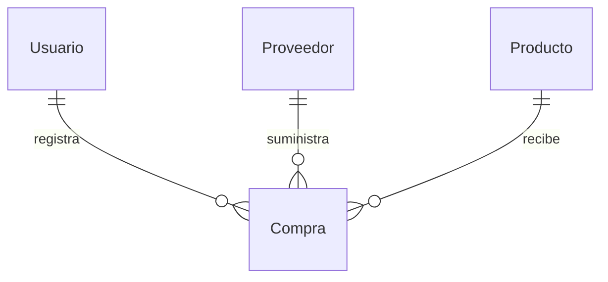

# Expediente técnico del caso Compras

Laboratorio 11 · Grupo B · Programación en Móviles Avanzado · Tecsup.

**Estado:** borrador preparado con asistencia de IA. No acredita trabajo manual previo ni visto bueno del docente. Debe revisarse y completarse por la estudiante antes de presentarlo.

## Integrantes y alcance

- Estudiante y propietaria del repositorio: SHEILA-DIAZ.
- Otros integrantes: por completar, si corresponde.
- Aplicación: Compras. Tecnología: SwiftUI y SwiftData, iOS 17 o posterior.
- Fuente: GLAB-S11-JLEONS-2026-02.pdf, reglas comunes de páginas 19–20, Grupo B de páginas 24–29 y plantilla de página 30.
- Referencia específica revisada el 2026-11-06: `Grupo B · Caso Compras (SwiftUI + SwiftData).pdf`, siete páginas con maquetas, reglas, rúbrica y nueve casos. El estado de verificación está en el README.
- Alcance propuesto: nueve pantallas B1–B9, nivel base, filtros y resumen del supervisor. No incluye el caso Ventas.

## Modelo de datos

| Modelo @Model | Propiedades de la guía | Relaciones |
| --- | --- | --- |
| Usuario | nombre, usuario, clave, rol: String | compras: [Compra], .deny, inversa comprador |
| Proveedor | nombre, ruc: String | compras: [Compra], .deny, inversa proveedor |
| Producto | nombre, categoria: String; stock: Int; costoPromedio: Double | compras: [Compra], .deny, inversa producto |
| Compra | fecha: Date; cantidad: Int; costoUnitario, igv, total: Double; alCredito: Bool; vence: Date; estado: String; pagada: Bool; motivoRechazo: String? | comprador: Usuario?; proveedor: Proveedor?; producto: Producto? |

Los padres no pueden borrarse si tienen compras, incluso si están pendientes o rechazadas. Se mantendrán .deny e inversas explícitas y se comprobará la restricción antes de guardar. Los precios se conservarán en Double como pide la guía; el cálculo de importes se realizará con Decimal y redondeo a céntimos. El costo promedio conservará precisión y se mostrará con dos decimales.

## Matriz de permisos

| Operación | Comprador | Supervisor |
| --- | --- | --- |
| Consultar y buscar productos/proveedores | Sí | Sí |
| Crear, editar o borrar productos/proveedores | No | Sí; borrar solo sin compras |
| Registrar compra | Sí | No se ofrece en su rol |
| Consultar compras | Solo las propias | Todas, desde Aprobar con filtro Todas |
| Aprobar o rechazar con motivo | No | Solo compras pendientes |
| Pagar | No | Solo aprobadas a crédito sin pagar |
| Resumen, inventario y crédito fiscal | No | Sí |
| Cerrar sesión | Sí | Sí |

Comprador: Productos, Proveedores, Compra, Mis compras. Supervisor: Resumen, Aprobar, Por pagar, Productos, Proveedores. La cuenta se presenta en el menú del avatar, sin una pestaña adicional. Los permisos se comprobarán también en las operaciones de negocio.

## Reglas y ejemplos

1. Subtotal = cantidad × costo unitario. IGV = 18 % del subtotal. Total = subtotal + IGV.
2. Total menor que S/ 5,000: compra aprobada al registrar. Desde S/ 5,000: pendiente, sin modificar stock, costo promedio ni cuentas por pagar.
3. Al aprobar: stock nuevo = stock previo + cantidad. Costo promedio = (stock previo × promedio previo + cantidad × costo unitario) / stock nuevo. No se aplica dos veces al repetir una aprobación.
4. Contado aprobado: pagada. Crédito aprobado: no pagada y vence 30 días después de la fecha de registro. Pendiente y rechazada no son cuentas por pagar. El vencimiento se interpreta desde fecha de compra, pues la guía no fija una fecha de aprobación para ese cálculo.
5. Rechazar exige motivo no vacío y no modifica inventario. Pagar solo cambia pagada; no vuelve a sumar stock ni IGV.
6. Inventario = suma de stock × costoPromedio. Crédito fiscal y totales por proveedor incluyen solo aprobadas. Por pagar incluye solo aprobadas a crédito no pagadas. Vencida exige además vence anterior a la fecha actual.
7. Usuario único sin distinguir mayúsculas: se normaliza al registrar e ingresar. Clave de seis caracteres como mínimo y confirmación coincidente. Inicio incorrecto: mensaje genérico. Sesión solo mientras la app está abierta.

**Ejemplo 1:** stock 40 a S/ 110; recibir 10 a S/ 120. Subtotal S/ 1,200; IGV S/ 216; total S/ 1,416; stock 50; promedio S/ 112. A crédito: vencimiento a 30 días y cuenta por pagar S/ 1,416.

**Ejemplo 2, independiente del anterior:** stock inicial 40 a S/ 110; recibir 50 a S/ 120. Subtotal S/ 6,000; IGV S/ 1,080; total S/ 7,080. Antes de aprobar: stock 40, promedio S/ 110. Después: stock 90, promedio mostrado S/ 115.56. La independencia de los ejemplos evita sumar dos veces el stock de las pruebas de la guía.

## Pantallas y datos

| Pantalla | Contenido y comportamiento |
| --- | --- |
| B1 Login | Logo, nombre Compras Tecsup, usuario, clave oculta, mensaje genérico, Ingresar y Crear cuenta |
| B2 Registro | Nombre, usuario con disponibilidad, clave y confirmación, selector de rol; registro inicia sesión |
| B3 Productos | Búsqueda, costo promedio, stock en color, inventario; +, edición y swipe de borrado solo supervisor |
| B4 Proveedores | Nombre, RUC, total aprobado e insignia Al día / por pagar; mantenimiento solo supervisor |
| B5 Nueva compra | Avatar, proveedor, producto, cantidad, costo unitario, forma de pago, cálculo y aviso de aprobación |
| B6 Mis compras | Solo propias, filtros Todas/Pendientes/Rechazadas, estado y motivo de rechazo |
| B7 Aprobar | Comprador que solicitó, resumen, efecto sobre inventario, Aprobar y Rechazar con motivo; filtro Todas para consulta del supervisor |
| B8 Por pagar | Filtros Pendientes/Vencidas/Pagadas, marca VENCIDA, swipe Pagar y total de obligaciones |
| B9 Resumen | Inventario, crédito fiscal, por pagar, pendientes de aprobación y barras por proveedor |

Se seguirán las maquetas de páginas 25–27. Formularios de mantenimiento y rechazo se presentarán como hojas de las pantallas indicadas. Ícono: 1024 × 1024, PNG sin transparencia, símbolo de compras sobre fondo de color, nombre corto Compras.

## Casos de prueba con resultado esperado

1. Registrar mtorres y luego MTORRES: el segundo se rechaza, sin usuario duplicado.
2. Clave incorrecta: mensaje Usuario o clave incorrectos; no inicia sesión.
3. Compra de 10 a 120 sobre stock 40/promedio 110, a crédito: aprobada, total 1,416, stock 50, promedio 112 y vence en 30 días.
4. Mismo caso al contado: pagada, sin obligación pendiente.
5. Compra de 50 a 120 sobre el stock inicial: pendiente por total 7,080; sin cambios de inventario ni cuentas por pagar.
6. Aprobar el caso 5: stock 90, promedio mostrado 115.56 y cuenta por pagar 7,080.
7. Rechazar sin motivo: bloqueo. Con motivo: rechazada, inventario intacto y motivo visible al comprador.
8. Crédito aprobado y vencido: aparece en Vencidas. Al pagar pasa a Pagadas y disminuye el total por pagar, sin alterar stock.
9. Comprador: no ve compras ajenas ni puede aprobar, rechazar o pagar.
10. Caso adicional: volver a aprobar una compra aprobada se rechaza; stock y promedio no cambian.
11. Caso adicional: subtotal 4,237.29, IGV redondeado 762.71, total exactamente 5,000: debe quedar pendiente.

## Plan de commits y uso de IA

1. Expediente y planificación.
2. Proyecto SwiftUI, modelos y contenedor persistente.
3. B1–B2: registro, login y sesión con roles.
4. B3: catálogo de productos y protección de borrado.
5. B4: proveedores y cálculos desde sus compras.
6. B5: registro, IGV y actualización transaccional de inventario.
7. B6: consultas propias y filtros.
8. B7: aprobación y rechazo con motivo.
9. B8: vencimientos y pago.
10. B9: resumen y gráfico; ícono de Compras.
11. Casos de prueba, capturas y verificación final.

El plan inicial contemplaba una entrega posterior en main. Por instrucción vigente de la propietaria, la continuación conserva main sin modificaciones y publica cada etapa únicamente en ia-asistida, sin squash ni force push. El remoto ya está conectado a `https://github.com/SHEILA-DIAZ/semana-12-movil`. La rama manual se reserva para trabajo hecho efectivamente sin asistencia: no se etiqueta código generado como manual. Cada consulta y sus decisiones se anotan en PROMPTS.md.

## Visto bueno del docente

Pendiente de confirmar por la estudiante. Registrar fecha y evidencia real de aprobación; no se inventará una aprobación ni se presentará este borrador como elaboración manual previa.
